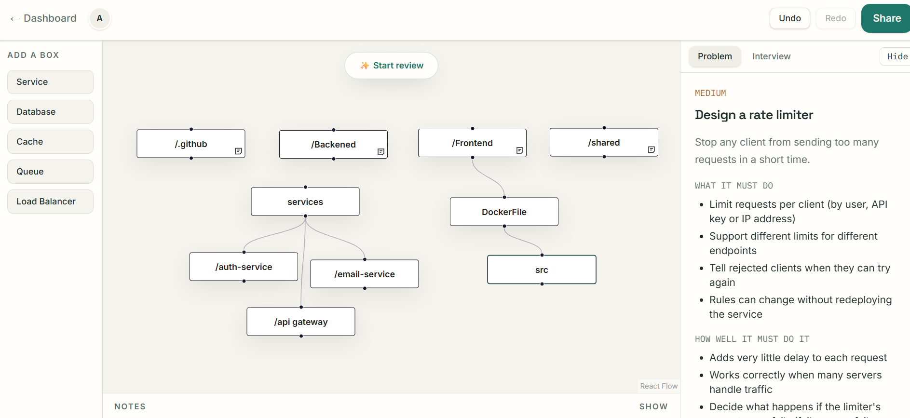
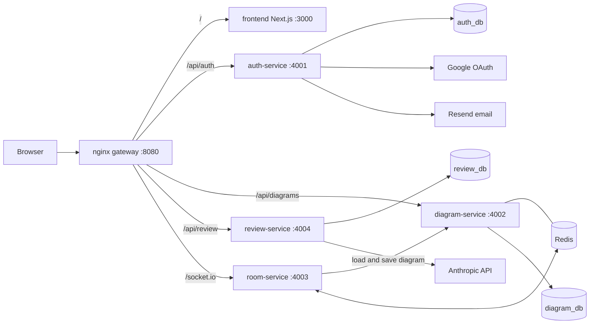
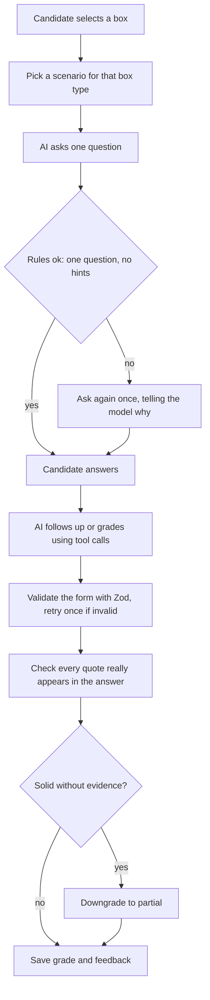

# DesignReview

Practice system design interviews in real time. Draw your architecture on a shared canvas, then get interviewed about it by an AI that asks one sharp question per component and grades your answers against evidence.

**Live demo:** [add link here once deployed]  
**Demo video (2 min):** [add link here]



## What it does

- **Shared canvas.** Draw services, databases, caches and queues with React Flow. Several people can edit the same diagram at once and see who else is in the room.
- **AI interviewer.** Click a component and the interviewer asks one question about it, based on a library of <<SCENARIOS>> system design scenarios. It follows up on vague answers, then grades the component as missed, partial or solid.
- **Review history.** Reviews survive a page refresh, can be resumed, renamed and revisited.

## Architecture



Four small services, each with its own database, behind one gateway. In the production setup only the gateway is reachable from outside; every other port is closed.

| Service | Job |
|---|---|
| `auth-service` | Sign up, email and Google login, refresh tokens in httpOnly cookies |
| `diagram-service` | Stores diagrams and prompts; caches diagram reads in Redis |
| `room-service` | Real-time sync over socket.io, presence, debounced saves (Redis adapter for scaling) |
| `review-service` | The AI interviewer, grader, review history, usage limits and tracing |
| `frontend` | Next.js 15, React 19, Tailwind 4 |

## How the AI review works



What I built around the model, not just a prompt:

- **Guardrails.** Questions are checked in code (one question, no hints). A bad question is rejected and regenerated once, with the reason.
- **Grounded grading.** The grader must quote the candidate. Quotes are verified against the real answer; invented quotes are dropped, and a "solid" grade without evidence becomes "partial".
- **Bounded conversation.** At most 2 follow-ups, then the box must be graded.
- **Structured output.** Tool calls validated with Zod; invalid output is retried once.
- **Prompt-injection hygiene.** User text is wrapped as untrusted data and cleaned before it reaches the model.
- **Tracing and cost control.** Every model call is recorded (model, latency, tokens, success, user). Each user is limited to 60 AI calls per hour, and all users together to 200 per day (configurable), so a public demo cannot run up the bill.
- **Evals.** 45 question-quality checks (100%) and 18 grader cases (18/18), run against the real model.

## Engineering

- **Tests.** 40 automated tests (unit tests for the interviewer and grader, route tests for auth, ownership, rate limits, double submits and status codes). The AI and the database are mocked, so tests are fast, free and repeatable.
- **CI.** GitHub Actions runs the tests and builds every Docker image on each push.
- **Docker.** One Dockerfile per service. `docker-compose.yml` is for development; `docker-compose.prod.yml` adds an nginx config that uses service names and closes every port except the gateway.
- **Security basics.** JWT access tokens plus refresh tokens in httpOnly cookies, Zod validation on every route, helmet, per-user rate limits, owner-only queries, secrets only in environment variables.
- **Resilience.** The Redis cache never blocks a request: if Redis is down, diagrams load from the database. Answering the same interview twice at once returns a clean 409 and calls the AI only once.

## Run it locally

You need Docker and Node 22.

1. Create a `.env` for each service (see `.env.example` in each folder). Never commit real keys.
2. Start everything in containers:

   ```bash
   docker compose -f docker-compose.yml -f docker-compose.prod.yml --profile apps up -d --build
   ```

3. Open http://localhost:8080

For day-to-day development, start only the databases with `docker compose up -d` and run each service with `npm run dev`.

## Decisions and trade-offs

- **Separate databases per service,** so services never read each other's tables.
- **Server is the source of truth for reviews,** so refreshing never loses a chat.
- **Cost-aware AI.** Short outputs, a small model, hard limits per user and per day, and tracing to see where tokens go.
- **Redis as a cache only.** Diagram reads are cached for 5 minutes and cleared on every change; the database stays the truth.
- **No streaming yet.** Answers arrive whole.

## Known limitations

- The grader can be lenient on partly correct answers; harder eval cases are planned.
- One shared debounce for diagram saves; it should be per diagram.
- The double-submit guard lives in memory, so it assumes a single review-service instance.

## Roadmap

CRDT editing (Yjs), recruiter report, event-driven notifications with RabbitMQ, streaming answers.
